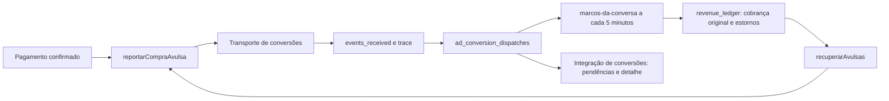

# Confirmação e recuperação das conversões

Destino: núcleo. Corrige a entrega de eventos já prometida, sem configuração nova.

O retorno altera a próxima decisão: `sent` impede novo envio pelo mesmo evento em qualquer negócio da organização; `error/plataforma_instavel` é elegível depois de 15 minutos. Um claim com o instante anterior impede dois crons de recuperar simultaneamente a mesma pendência. Duas compras por rodada limitam o trabalho. Valor, moeda, referência e data vêm do livro financeiro; sem leitura confiável, com estorno/ajuste ou acima de sete dias não há envio. Falha permanece na tela existente; a recuperação efetiva entra no audit do cron e no seu resumo.

O HTTP 200 direto só vira sucesso com `events_received: 1`. O detalhe guarda o trace e a quantidade de avisos, sem copiar o corpo do evento ou dados pessoais. Recibo não é prova de atribuição: ela exige conciliar o relatório da conta e o Gerenciador de Eventos. A nota oficial de correspondência não é uma nota atribuída pelo sistema.

Prova: testes do transporte (200 vazio/zero/malformado), recuperação (claim, data e valor originais, estorno, ajuste, falha de leitura), e identidade do envio entre negócios e organizações. O backend desta mudança não altera a jornada nem adiciona tela.
